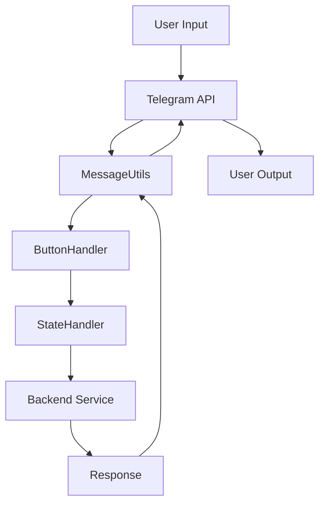
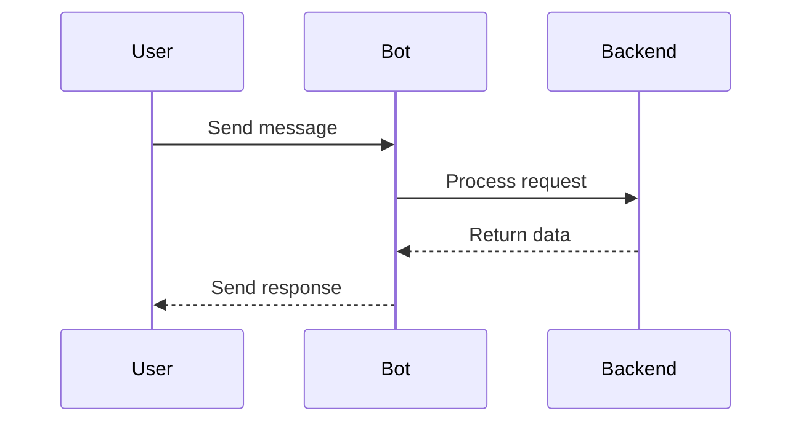
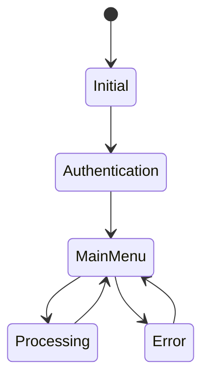

# Architecture Documentation

## System Overview
The LunaX Telegram Bot is built using a modular architecture that separates concerns and promotes maintainability. The system consists of several key components that work together to provide a seamless user experience.

## Component Architecture

### 1. Core Components
```
com.lunax.telegramBot
├── utils
│   └── components
│       ├── MessageUtils.java
│       └── ButtonHandler.java
└── component
    └── navigation
        └── components
            └── StateHandler.java
```

### 2. Message Flow


## Component Details

### MessageUtils
- Central utility class for message handling
- Provides abstraction layer for Telegram API
- Handles message formatting and delivery
- Manages keyboard interactions

### ButtonHandler
- Interface for button interaction handling
- Defines contract for button callbacks
- Manages state transitions
- Handles user input processing

### StateHandler
- Manages application state
- Handles navigation flow
- Supports pagination
- Coordinates with backend service

## Backend Integration

### Communication Flow
1. User interacts with bot
2. MessageUtils processes input
3. ButtonHandler/StateHandler processes action
4. Backend service receives request
5. Response processed and formatted
6. User receives response

### Data Flow


## State Management

### Chat States
- Initial state
- Authentication state
- Main menu state
- Processing state
- Error state

### State Transitions


## Error Handling

### Error Types
1. Network errors
2. Authentication errors
3. Processing errors
4. State transition errors

### Error Recovery
- Automatic retry for network errors
- State rollback for failed transitions
- User-friendly error messages
- Logging and monitoring

## Security Architecture

### Authentication Flow
1. User initiates authentication
2. Backend validates credentials
3. JWT token generated
4. Token used for subsequent requests

### Data Protection
- HTTPS for all communications
- Token-based authentication
- Input validation
- Output sanitization

## Performance Considerations

### Caching Strategy
- Message caching
- State caching
- Response caching
- Rate limiting

### Resource Management
- Connection pooling
- Thread management
- Memory optimization
- Response compression

## Monitoring and Logging

### Logging Levels
- ERROR: Critical issues
- WARN: Potential problems
- INFO: Normal operations
- DEBUG: Detailed information

### Metrics Collection
- Response times
- Error rates
- State transition times
- Resource usage

## Deployment Architecture

### Development Environment
```
localhost:3000 (Backend)
└── Telegram Bot
    └── Local Development
```

### Production Environment
```
Load Balancer
├── Backend Service 1
├── Backend Service 2
└── Telegram Bot
```

## Scaling Strategy

### Horizontal Scaling
- Multiple backend instances
- Load balancing
- State synchronization
- Database replication

### Vertical Scaling
- Resource optimization
- Performance tuning
- Memory management
- CPU utilization

## Maintenance Procedures

### Regular Maintenance
1. Log rotation
2. Database cleanup
3. Performance monitoring
4. Security updates

### Backup Procedures
1. Database backups
2. Configuration backups
3. State backups
4. Recovery testing

## Development Guidelines

### Code Organization
- Package structure
- Naming conventions
- Documentation requirements
- Testing requirements

### Best Practices
1. Error handling
2. Logging
3. State management
4. Security
5. Performance 